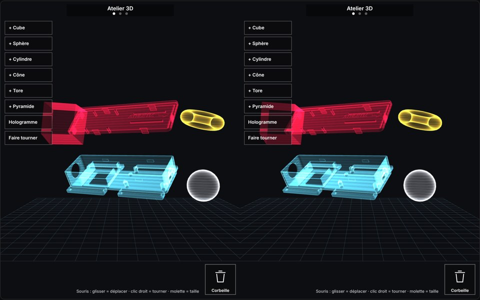

# Vision Main — atelier 3D piloté par les mains

🇫🇷 [Français](#français) · 🇬🇧 [English](#english)

**▶ [Essayer l'application en ligne](https://valentin-auger-laboratoire.github.io/portfolio/demos/vision-main/)** — dans le navigateur, rien n'est envoyé · *[Try it online](https://valentin-auger-laboratoire.github.io/portfolio/demos/vision-main/)*



---

## Français

### L'idée
Manipuler des pièces 3D avec les mains, sans souris, comme des objets réels : devant la webcam d'un ordinateur, ou dans un **casque où l'on glisse son téléphone**. Dans le casque, l'écran se coupe en deux (une image par œil), la caméra arrière filme ce qu'il y a devant soi, on voit ses propres mains, et les pièces flottent dans la pièce.

### Atelier 3D
- **Importer n'importe quelle pièce** STL (binaire ou texte) ou OBJ, par exemple un export de Fusion 360 ou SolidWorks (glisser le fichier sur l'image, ou bouton « Importer »). Les pièces de CAO en « Z vers le haut » sont remises droites ; les dimensions d'origine sont affichées.
- **Faire apparaître des formes** : cube, sphère, cylindre, cône, tore, pyramide (d'une pince sur la colonne de boutons dessinée dans l'image, utilisable dans le casque).
- **Saisir** une pièce d'une pince pouce + index : elle suit la main en 3D, **recule ou avance** avec elle (la profondeur suit la taille apparente de la main) et **tourne comme la main** (orientation de la paume en 3D).
- **Lâcher en tournant** : la pièce continue de tourner sur elle-même, puis ralentit.
- **Deux mains** sur la même pièce : écarter pour l'agrandir, rapprocher pour la réduire, tourner les mains pour la faire pivoter.
- **Supprimer** : la lâcher sur la corbeille.
- Rendu **plein** ou **hologramme**, rotation continue, **export de la scène en STL** (en mm) pour la reprendre en CAO.
- Aussi à la souris ou au doigt : glisser = déplacer, clic droit = tourner, molette = taille.

### Changer de page d'un geste
Un **balayage de la main ouverte** passe à la page suivante ou précédente :
- **Langue des signes** : l'alphabet **LSF ou ASL** est lu lettre par lettre (24 lettres ; J et Z demandent un mouvement), pour une personne qui ne parle pas. La lettre tenue 0,9 s s'ajoute au message, qui peut être lu à voix haute. On peut enregistrer ses propres exemples. Avec la caméra arrière ou le casque, on lit les signes de la personne en face.
- **Visage** : maillage de 478 points et **expression** du visage filmé (content, surpris, triste, contrarié, neutre), déduite des 52 coefficients d'expression du modèle, avec calibration du visage au repos. Sur un ordinateur : son propre visage ; à travers le casque : celui des autres. C'est de la reconnaissance d'expressions, **pas d'identification**, et une expression n'est pas une émotion.

### Mode casque
Écran coupé en deux, **vue stéréo** (écart des yeux réglable), caméra arrière, plein écran en paysage, et **gyroscope du téléphone** : les pièces restent à leur place quand on tourne la tête. Il fonctionne sur les trois pages.

### Ce qui est écrit à la main (`demo/`)
| Fichier | Contenu |
|---|---|
| `m3d.js` | vecteurs, quaternions, matrices, perspective, rayon depuis un pixel, intersections rayon / boîte et rayon / triangle |
| `formes.js` | lecture STL / OBJ, normales, recentrage, formes de base, écriture STL |
| `rendu.js` | moteur WebGL : fond caméra, éclairage, style hologramme, profondeur, vue stéréo |
| `gestes.js` | pince avec hystérésis, main ouverte, poing, repère de la paume en 3D, balayage |
| `atelier.js` | viser, saisir, déplacer, tourner, lancer, deux mains, corbeille |
| `signes.js`, `modesignes.js` | alphabet des signes (repère de la main, 22 caractéristiques, modèles d'une main de synthèse, exemples personnels) |
| `humeur.js`, `modevisage.js` | expression du visage à partir des coefficients du modèle |
| `app.js` | pages, caméra avant / arrière, mode casque, gyroscope, import / export |

La détection des mains et du visage vient de **MediaPipe Tasks Vision** (Google, Apache 2.0), fournie dans `demo/lib` avec ses modèles (voir `demo/lib/NOTICE.txt`).

### Tests
```bash
node demo/tests/test.js
```
2 888 vérifications : formes (volume exact de chaque forme fermée, normales vers l'extérieur, STL écrit puis relu à l'identique, STL texte, OBJ, fichiers refusés), calcul 3D (quaternions, matrices, projection ↔ rayon), gestes (pince, main ouverte, poing, orientation de la main retrouvée à 10⁻⁶ rad, balayage), atelier (la pièce suit la main à l'écran, profondeur divisée par 2 quand la main paraît 2 fois plus grande, rotation transmise, lancer puis arrêt, deux mains, corbeille, boutons), signes et expressions.

Vérifié aussi dans Chromium avec une caméra simulée : pièce STL importée et manipulée, mains détectées sur une vidéo, mode casque, lettre V lue, sourire lu « content ». Les gestes devant une vraie caméra et le casque avec un vrai téléphone restent à essayer.

Lancer en local : `python -m http.server` dans `demo`, puis ouvrir `http://localhost:8000` (la caméra demande une page servie, pas un fichier ouvert directement ; sur téléphone, il faut du HTTPS : la version en ligne).

### Premier prototype (Python, mars 2026)
`app.py` (suivi de la main et bouton QUITTER au doigt) et `construction_gestes.py` (cubes posés par pince) sont les premiers essais, avec OpenCV et MediaPipe 0.10.21 (`pip install -r requirements.txt`, Python 3.9 à 3.12).

---

## English

### The idea
Handle 3D parts with your hands, no mouse, like real objects: in front of a computer webcam, or inside a **headset you slide your phone into**. In the headset the screen splits in two (one image per eye), the rear camera films what is in front of you, you see your own hands, and the parts float in the room.

### 3D workshop
- **Import any part**: STL (binary or text) or OBJ, e.g. a Fusion 360 or SolidWorks export (drop the file on the image or use "Import"). CAD parts with Z up are set upright; original dimensions are shown.
- **Spawn shapes**: cube, sphere, cylinder, cone, torus, pyramid (by pinching on the button column drawn in the image, usable in the headset).
- **Grab** a part with a thumb + index pinch: it follows the hand in 3D, **moves closer or further** with it (depth follows the apparent hand size) and **turns like the hand** (3D palm orientation).
- **Release while turning**: the part keeps spinning, then slows down.
- **Both hands** on the same part: spread to enlarge, bring together to shrink, turn the hands to rotate it.
- **Delete**: release it over the bin.
- **Solid** or **hologram** rendering, continuous spin, **scene export to STL** (mm) to take it back to CAD.
- Also with the mouse or a finger: drag = move, right click = turn, wheel = size.

### Changing page with a gesture
A **swipe of the open hand** goes to the next or previous page:
- **Sign language**: the **LSF or ASL** alphabet is read letter by letter (24 letters; J and Z need a movement), for someone who cannot speak. A letter held for 0.9 s is added to the message, which can be read aloud. You can record your own examples. With the rear camera or the headset, you read the signs of the person facing you.
- **Face**: 478-point mesh and the **expression** of the filmed face (happy, surprised, sad, annoyed, neutral), inferred from the model's 52 expression coefficients, with calibration of the resting face. On a computer: your own face; through the headset: other people's. This is expression recognition, **not identification**, and an expression is not an emotion.

### Headset mode
Split screen, **stereo view** (adjustable eye separation), rear camera, landscape full screen, and the **phone's gyroscope**: parts stay in place when you turn your head. Works on all three pages.

### Hand-written code (`demo/`)
`m3d.js` (3D maths), `formes.js` (STL / OBJ reader, shapes, STL writer), `rendu.js` (WebGL engine, stereo), `gestes.js` (gestures), `atelier.js` (grab, move, rotate, throw, two hands, bin), `signes.js` + `modesignes.js` (sign alphabet), `humeur.js` + `modevisage.js` (facial expression), `app.js` (pages, front / rear camera, headset, gyroscope, import / export). Hand and face detection come from **MediaPipe Tasks Vision** (Google, Apache 2.0), shipped in `demo/lib` with its models.

### Tests
```bash
node demo/tests/test.js
```
2,888 checks: shapes (exact volumes, outward normals, STL write/read round trip, text STL, OBJ, rejected files), 3D maths, gestures (pinch, open hand, fist, hand orientation recovered to 10⁻⁶ rad, swipe), workshop (the part follows the hand, depth halves when the hand looks twice as big, rotation transfer, throw then stop, two hands, bin, buttons), signs and expressions. Also checked in Chromium with a simulated camera; real-camera gestures and a real phone headset remain to be tried.

### First prototype (Python, March 2026)
`app.py` (hand tracking and a QUIT button pressed with a finger) and `construction_gestes.py` (cubes placed by pinching) are the first experiments, with OpenCV and MediaPipe 0.10.21.
