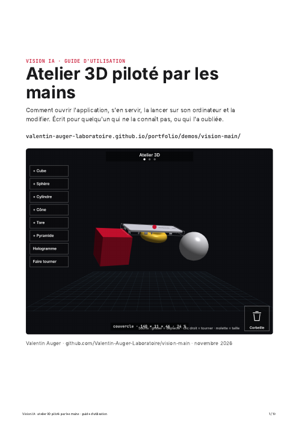

# Vision Main — atelier 3D piloté par les mains

🇫🇷 [Français](#français) · 🇬🇧 [English](#english)

**▶ [Essayer l'application en ligne](https://valentin-auger-laboratoire.github.io/portfolio/demos/vision-main/)** · **📘 [Guide d'utilisation (PDF)](docs/guide-utilisation.pdf)** — dans le navigateur, rien n'est envoyé · *[Try it online](https://valentin-auger-laboratoire.github.io/portfolio/demos/vision-main/)*


---

## Français

### 📘 Guide d'utilisation
Tout est expliqué pas à pas dans le **[guide d'utilisation (PDF, 10 pages)](docs/guide-utilisation.pdf)**, écrit pour quelqu'un qui découvre l'application ou qui l'a oubliée : ouvrir l'application et autoriser la caméra, changer de page avec le menu à deux mains, tous les gestes de l'atelier, importer et exporter une pièce, la langue des signes, le visage, le mode casque, les problèmes fréquents et leurs solutions, la lancer sur son ordinateur, comment le code est construit, lancer les tests et publier une nouvelle version.

<a href="docs/guide-utilisation.pdf"></a>

### L'idée
Manipuler des pièces 3D avec les mains, sans souris, comme des objets réels, **devant la webcam de son ordinateur** (elle filme l'utilisateur). En option, un mode casque pour téléphone coupe l'écran en deux.

### Atelier 3D
- **Importer n'importe quelle pièce** STL (binaire ou texte) ou OBJ, par exemple un export de Fusion 360 ou SolidWorks (glisser le fichier sur l'image, ou bouton « Importer »). Les pièces de CAO en « Z vers le haut » sont remises droites ; les dimensions d'origine sont affichées.
- **Faire apparaître des formes** : cube, sphère, cylindre, cône, tore, pyramide (d'une pince sur la colonne de boutons dessinée dans l'image, utilisable dans le casque).
- **Saisir** une pièce d'une pince pouce + index : elle suit la main en 3D, **recule ou avance** avec elle (la profondeur suit la taille apparente de la main) et **tourne comme la main** (orientation de la paume en 3D).
- **Lâcher en tournant** : la pièce continue de tourner sur elle-même, puis ralentit.
- **Deux mains** sur la même pièce : écarter pour l'agrandir, rapprocher pour la réduire, tourner les mains pour la faire pivoter.
- **Supprimer** : la lâcher sur la corbeille.
- Rendu **plein** ou **hologramme**, rotation continue, **export de la scène en STL** (en mm) pour la reprendre en CAO.
- Aussi à la souris ou au doigt : glisser = déplacer, clic droit = tourner, molette = taille.

### Changer de page d'un geste
**Une seule page agit à la fois** : en langue des signes, les gestes ne déplacent pas les pièces, et dans l'atelier aucune lettre n'est lue. Pour changer de page, on garde **les deux mains ouvertes pendant 1 s** : le menu des pages s'affiche dans l'image et on pince la page voulue (aucune lettre de l'alphabet ne se fait à deux mains, donc pas de changement par accident).
- **Langue des signes** : l'alphabet **LSF ou ASL** est lu lettre par lettre (24 lettres ; J et Z demandent un mouvement), pour une personne qui ne parle pas : la webcam lit ses signes, la lettre tenue 0,9 s s'ajoute au message, qui peut être lu à voix haute. On peut enregistrer ses propres exemples.
- **Visage** : maillage de 478 points et **expression** du visage filmé (content, surpris, triste, contrarié, neutre), déduite des 52 coefficients d'expression du modèle, avec calibration du visage au repos : la webcam filme le visage de l'utilisateur. C'est de la reconnaissance d'expressions, **pas d'identification**, et une expression n'est pas une émotion.

### Mode casque (option)
Écran coupé en deux, **vue stéréo** (écart des yeux réglable), caméra arrière, plein écran en paysage, et **gyroscope du téléphone** : les pièces restent à leur place quand on tourne la tête. Il fonctionne sur les trois pages.

### Ce qui est écrit à la main (`demo/`)
| Fichier | Contenu |
|---|---|
| `m3d.js` | vecteurs, quaternions, matrices, perspective, rayon depuis un pixel, intersections rayon / boîte et rayon / triangle |
| `formes.js` | lecture STL / OBJ, normales, recentrage, formes de base, écriture STL |
| `rendu.js` | moteur WebGL : fond caméra, éclairage, style hologramme, profondeur, vue stéréo |
| `gestes.js` | pince avec hystérésis, main ouverte, poing, repère de la paume en 3D, geste tenu (menu à deux mains) |
| `atelier.js` | viser, saisir, déplacer, tourner, lancer, deux mains, corbeille |
| `signes.js`, `modesignes.js` | alphabet des signes (repère de la main, 22 caractéristiques, modèles d'une main de synthèse, exemples personnels) |
| `humeur.js`, `modevisage.js` | expression du visage à partir des coefficients du modèle |
| `app.js` | pages, caméra avant / arrière, mode casque, gyroscope, import / export |

La détection des mains et du visage vient de **MediaPipe Tasks Vision** (Google, Apache 2.0), fournie dans `demo/lib` avec ses modèles (voir `demo/lib/NOTICE.txt`).

### Tests
```bash
node demo/tests/test.js
```
2 891 vérifications : formes (volume exact de chaque forme fermée, normales vers l'extérieur, STL écrit puis relu à l'identique, STL texte, OBJ, fichiers refusés), calcul 3D (quaternions, matrices, projection ↔ rayon), gestes (pince, main ouverte, poing, menu à deux mains ouvertes, orientation de la main retrouvée à 10⁻⁶ rad), atelier (la pièce suit la main à l'écran, profondeur divisée par 2 quand la main paraît 2 fois plus grande, rotation transmise, lancer puis arrêt, deux mains, corbeille, boutons), signes et expressions.

Vérifié aussi dans Chromium avec une caméra simulée : pièce STL importée et manipulée, mains détectées sur une vidéo, mode casque, lettre V lue, sourire lu « content ». Les gestes devant une vraie caméra et le casque avec un vrai téléphone restent à essayer.

Lancer en local : `python -m http.server` dans `demo`, puis ouvrir `http://localhost:8000` (la caméra demande une page servie, pas un fichier ouvert directement ; sur téléphone, il faut du HTTPS : la version en ligne).

### Premier prototype (Python, mars 2026)
`app.py` (suivi de la main et bouton QUITTER au doigt) et `construction_gestes.py` (cubes posés par pince) sont les premiers essais, avec OpenCV et MediaPipe 0.10.21 (`pip install -r requirements.txt`, Python 3.9 à 3.12).

---

## English

### 📘 User guide
A step-by-step **[user guide (PDF, in French, 10 pages)](docs/guide-utilisation.pdf)** covers opening the app and allowing the camera, the two-hands page menu, every workshop gesture, part import / export, sign language, face, headset mode, common problems, running it locally, how the code is built, tests and publishing a new version.

### The idea
Handle 3D parts with your hands, no mouse, like real objects, **in front of your computer webcam** (it films the user). An optional phone-headset mode splits the screen in two.

### 3D workshop
- **Import any part**: STL (binary or text) or OBJ, e.g. a Fusion 360 or SolidWorks export (drop the file on the image or use "Import"). CAD parts with Z up are set upright; original dimensions are shown.
- **Spawn shapes**: cube, sphere, cylinder, cone, torus, pyramid (by pinching on the button column drawn in the image, usable in the headset).
- **Grab** a part with a thumb + index pinch: it follows the hand in 3D, **moves closer or further** with it (depth follows the apparent hand size) and **turns like the hand** (3D palm orientation).
- **Release while turning**: the part keeps spinning, then slows down.
- **Both hands** on the same part: spread to enlarge, bring together to shrink, turn the hands to rotate it.
- **Delete**: release it over the bin.
- **Solid** or **hologram** rendering, continuous spin, **scene export to STL** (mm) to take it back to CAD.
- Also with the mouse or a finger: drag = move, right click = turn, wheel = size.

### Changing page with a gesture
**Only one page acts at a time**: in sign language, gestures do not move parts, and in the workshop no letter is read. To change page, keep **both hands open for 1 s**: the page menu appears in the image and you pinch the page you want (no alphabet letter uses two hands, so no accidental change).
- **Sign language**: the **LSF or ASL** alphabet is read letter by letter (24 letters; J and Z need a movement), for someone who cannot speak: the webcam reads their signs, a letter held for 0.9 s is added to the message, which can be read aloud. You can record your own examples.
- **Face**: 478-point mesh and the **expression** of the filmed face (happy, surprised, sad, annoyed, neutral), inferred from the model's 52 expression coefficients, with calibration of the resting face: the webcam films the user's face. This is expression recognition, **not identification**, and an expression is not an emotion.

### Headset mode (option)
Split screen, **stereo view** (adjustable eye separation), rear camera, landscape full screen, and the **phone's gyroscope**: parts stay in place when you turn your head. Works on all three pages.

### Hand-written code (`demo/`)
`m3d.js` (3D maths), `formes.js` (STL / OBJ reader, shapes, STL writer), `rendu.js` (WebGL engine, stereo), `gestes.js` (gestures), `atelier.js` (grab, move, rotate, throw, two hands, bin), `signes.js` + `modesignes.js` (sign alphabet), `humeur.js` + `modevisage.js` (facial expression), `app.js` (pages, front / rear camera, headset, gyroscope, import / export). Hand and face detection come from **MediaPipe Tasks Vision** (Google, Apache 2.0), shipped in `demo/lib` with its models.

### Tests
```bash
node demo/tests/test.js
```
2,891 checks: shapes (exact volumes, outward normals, STL write/read round trip, text STL, OBJ, rejected files), 3D maths, gestures (pinch, open hand, fist, two-open-hands menu, hand orientation recovered to 10⁻⁶ rad), workshop (the part follows the hand, depth halves when the hand looks twice as big, rotation transfer, throw then stop, two hands, bin, buttons), signs and expressions. Also checked in Chromium with a simulated camera; real-camera gestures and a real phone headset remain to be tried.

### First prototype (Python, March 2026)
`app.py` (hand tracking and a QUIT button pressed with a finger) and `construction_gestes.py` (cubes placed by pinching) are the first experiments, with OpenCV and MediaPipe 0.10.21.
